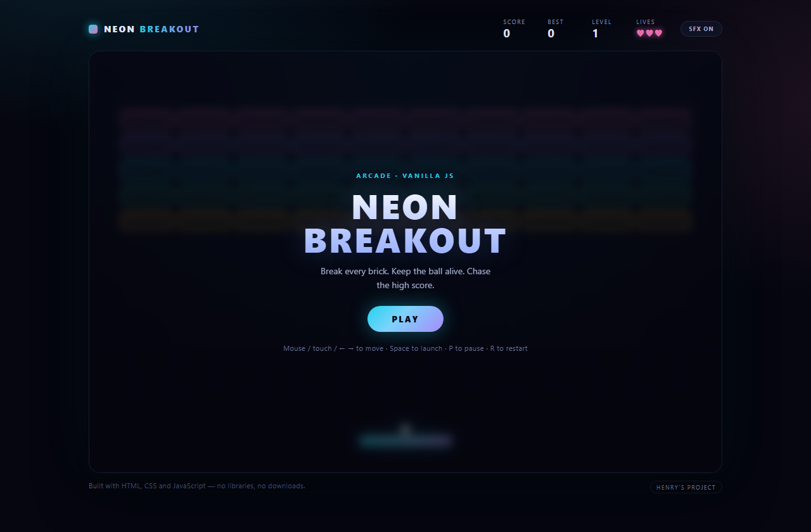

# Neon Breakout

A small arcade game built from scratch with HTML, CSS and JavaScript. It is a single file with no libraries, no image assets and no build step, and it runs offline in any modern browser.



## My inspiration

My inspiration comes from the classic arcade brick-breakers — *Breakout* and *Arkanoid*. I like that the rules fit into one sentence: keep the ball in play and clear every brick. There is no long tutorial and no complicated menu; the fun comes from angle, timing and a little luck.

For this class 10 project I wanted to rebuild that simple loop for the browser, but with a modern look: a dark space background, glowing bricks and a neon arcade palette. I also wanted to show that a finished, playable game does not need a big engine or a build tool — just the web technologies we learned in class.

The "neon arcade" style is inspired by synthwave posters and old arcade cabinets. The single-file design comes from a practical goal: I wanted to be able to send the game to a friend as one file and have it work immediately, even without internet. The ball trail, particle effects and generated sound effects are small details that make it feel complete without adding any dependencies.

## How to play

| Action | Control |
| --- | --- |
| Move the paddle | Mouse, touch, `←` `→` or `A` / `D` |
| Launch the ball | `Space` or click / tap the board |
| Pause and resume | `P` or `Esc` |
| Restart | `R` |
| Sound on / off | `M` or the SFX button |

Break every brick to clear the level. Each brick is worth 10 points, and clearing a level adds a 250-point bonus. The ball gets a little faster each level. You start with three lives, and you lose one if the ball falls below the paddle. Your best score is saved in the browser.

## Features

- Canvas 2D rendering with a neon glow, ball trail and particle effects
- Angle-based paddle bounces and sub-stepped collision detection
- Endless levels with increasing ball speed
- Mouse, touch and keyboard controls
- Sound effects generated with the Web Audio API — no audio files
- High score saved with `localStorage`
- Pause, restart, reduced-motion support and a responsive layout
- Completely offline, with no external requests

## Complete code

The complete, runnable source code is attached in this folder as [`index.html`](index.html). Everything is in that one file:

- the page structure and HUD (HTML),
- the neon theme and responsive layout (CSS),
- the game setup, level builder, physics, rendering, input handling and main loop (JavaScript).

There are no hidden files, generated bundles or third-party libraries — opening `index.html` in a text editor shows the whole project.

## Project files

```
.
├── index.html      # the complete game (HTML + CSS + JavaScript)
├── README.md       # this introduction
└── screenshot.png  # title screen
```

## Run the game

Double-click `index.html`, or serve the folder locally:

```bash
python -m http.server 8000
```

Then open <http://localhost:8000/> in a browser.

## A few implementation notes

- The game draws to a fixed 900 × 600 canvas that scales with CSS, so the layout stays the same on different screens.
- The ball moves in small sub-steps so it cannot pass through a brick at high speed.
- Brick collisions find the closest point on the brick and reflect the ball around the surface normal.
- The paddle bounce angle depends on where the ball hits, which gives the player control over the direction.
- A small state machine handles the `menu`, `playing`, `paused` and `over` states.

Built by Henry, 2026.
